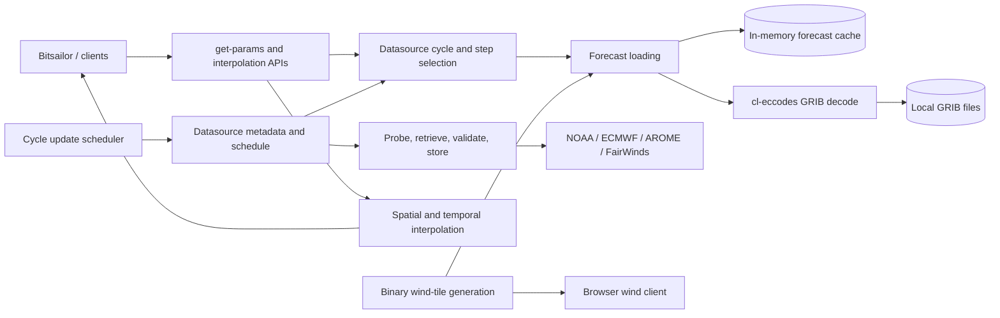

# cl-weather Architecture

`cl-weather` is a Common Lisp system for locating, downloading, decoding, caching, and sampling forecast GRIB data. It supports several data products and serves two distinct consumers: Bitsailor's server-side route simulation and a browser-facing wind-tile path. These responsibilities are implemented as serially loaded source files in one ASDF system and one package, but they form several separable subsystems.

## System Shape



The ASDF definition in [cl-weather.asd](cl-weather.asd) loads the system in this order: shared configuration and types, GRIB decoding, datasource definitions, provider-specific data sources, downloading and cycle updates, forecast loading, interpolation, then tile generation. Its main dependencies are `cl-eccodes` for GRIB decoding, `cl-geomath` for vector and geographic calculations, and `local-time` for timestamps. It also uses `cl-map` and `curl`/`uiop`-based helpers.

The `cl-weather/test` ASDF system uses FiveAM and runs through `asdf:test-system "cl-weather"`. Forecast-selection tests use a deterministic test datasource and stub forecast loader; interpolation tests use small synthetic grids, so the suite does not access remote services or require cached GRIB files.

The code is organized into files, not package or process boundaries. Most source files share `CL-WEATHER` globals and types. The architecture below describes both those logical components and the important places where their current contracts do not line up.

## Datasource Model

The base `datasource` class in [datasource.cl](datasource.cl) carries a source name, remote location, release schedule, resolution, cycle, and maximum forecast step. Mixins distinguish `range-download` from `file-download`; data-kind classes distinguish wind U/V, current U/V, and scalar wave products. A schedule contains run hours, forecast steps, and dissemination start/end minutes.

Provider behavior is supplied through generic methods such as `datasource-schedule`, `current-cycle`, `timestamp-cycle`, `cycle-forecast`, `next-forecast`, `data-uri`, `index-uri`, `probe-uris`, `local-pathname`, and `load-datasource-forecasts`. In normal use, the public-facing selector takes a datasource class symbol and timestamp; `get-datasource` constructs or retrieves an instance for a particular cycle. Several methods specialize on the datasource symbol, others on an instance class, and provider files supply the bridge between those conventions.

| Provider | Present in scheduled update list | Declared behavior | Current support status |
| --- | --- | --- | --- |
| NOAA GFS wind | Yes | Four six-hourly runs; three-hour steps through 384 hours; indexed byte-range downloads of 10 m U/V wind | Main complete path |
| Combined GFS waves | Yes | Daily cycle; six-hour forecast steps; full-file GRIB download; scalar significant wave height sampling | Used by Bitsailor when waves are enabled; the 48-hour `maxstep` conflicts with its 168-hour step selection |
| AROME wind | Yes | Four six-hourly runs; three-hour leads from 6 to 48 hours; regional full-file downloads scheduled 260 minutes after each run | Implemented for default `western_med` region |
| FairWinds currents | Yes, three regions | Daily cycle and one downloaded GRIB file per region; six-hourly forecast selection | Used by Bitsailor; the declared 48-hour maximum conflicts with selection through 168 hours |
| ECMWF IFS wind | Yes | Four six-hourly cycles; 0.25-degree range downloads of 10 m U/V wind; 3-hourly leads through 144 h and 6-hourly through 360 h on 00/12 runs | Complete route-computation path; 06/18 runs are capped at 144 h |
| ECMWF AIFS wind | No | Datasource class, schedule, and Open Data URLs are declared | Not active in scheduled downloads or route selection |
| NOAA RTOFS currents | No | Schedule, remote URL, and full-file download path are declared | Not end-to-end: no implemented timestamp-cycle/forecast selection or specialized forecast loader |
| NOAA AIGFS wind | No | Datasource class and URL root are declared | Incomplete: no schedule or cycle/step methods |

The scheduled set is the private `*datasources*` list in [cycle-update.cl](cycle-update.cl). It contains GFS and ECMWF IFS wind, combined GFS waves, AROME, and the three FairWinds current products. Declaring a datasource class does not by itself make it periodically downloaded or usable through `get-params`.

ECMWF IFS Open Data uses 00, 06, 12, and 18 UTC cycles. Files begin dissemination about 5 h 45 min after cycle initialization; 00/12 runs finish around 7 h 34 min and extend to 360 h, while 06/18 runs finish around 6 h 27 min and stop at 144 h. The 10 m wind fields available from the checked Open Data endpoint use 3-hour leads through 144 h and 6-hour leads thereafter on 00/12 runs. IFS forecasts are selected at 0.25-degree resolution. The cycle selector chooses the newest available run that covers the requested timestamp, and `cycle-forecast`/`next-forecast` bracket the time using that run's lead-time ladder. Existing temporal and spatial U/V interpolation is shared with GFS; no IFS-specific interpolation is required. Asking the download queue for unpublished lead steps can stall a cycle because each missing file is retried for up to 90 minutes.

## Download And File Lifecycle

`start-cycle-updates` initiates downloads for the latest theoretically complete cycle of each active datasource, also starts the current cycle if it is still being disseminated, schedules later downloads, and installs forecast-cache cleanup. `schedule-download` derives timer hours from each run plus `dissem-start`. Although schedules contain `dissem-end`, that value is not used to control downloads.

`download-datasource` iterates through scheduled steps. `:async :datasource` creates a worker thread per datasource, while downloads within a datasource run in sequence. `download-step` skips an already-existing path, probes remote availability, downloads, validates newly fetched files, and retries unavailable or failed downloads at 30-second intervals (up to 180 tries by default).

Two download strategies are represented:

- `range-download` reads the provider index, determines byte ranges, downloads each range separately, and concatenates the pieces into the local GRIB file. This accommodates sources where full files are large or a server only honors one byte range per request.
- `file-download` retrieves a complete GRIB file. AROME, RTOFS, FairWinds currents, and combined waves use this route.

Provider methods build remote and local paths. The base path includes source name, resolution, cycle date/run, and forecast step; AROME and FairWinds products override that layout. `datasource-info` exposes current active-source names and relative GRIB paths for the browser-facing server settings API.

Network work is not performed through a common HTTP client abstraction. `download.cl` invokes `curl` through `uiop:run-program`; `curl-wrapper.cl` has a separate HTTP response parser used for index retrieval and availability checks. These requests and GRIB transfers have finite connect/overall timeouts; downloader logs report availability probes, index retrieval, each byte range, and retry/failure details. NOAA GFS range extraction assumes the UGRD 10 m and VGRD 10 m entries are consecutive in the `.idx` file. ECMWF index retrieval parses JSON index entries and selects the U/V parameters. The AROME and FairWinds providers use provider-specific full-file paths.

`cleanup-cycles` scans only the `1p00` and `0p25` directory trees, deletes most old forecast offsets, archives selected early offsets, then removes empty directories. Other layouts such as the AROME and FairWinds paths are not covered by those two glob patterns.

## GRIB Decode And Forecast Cache

[gribfile.cl](gribfile.cl) turns eccodes messages into normalized Lisp data. A `gribmessage` represents one scalar field with parameter metadata, base time, forecast step, grid metadata, and its values array. A `uv` represents paired U/V arrays plus grid geometry, cycle, and forecast offset. The `gribinfo` structure captures grid dimensions, coordinate bounds, increments, and scan directions; `uv-index` maps normalized coordinates to the flat array index.

NOAA-style indexed loading selects the configured U and V short names for each forecast step, decodes them, and stores every available step. The FairWinds reader instead consumes messages in pairs and assumes each pair is U then V. Wave loading selects a fixed GRIB parameter tuple and caches scalar `gribmessage` objects.

`load-forecast` in [forecast.cl](forecast.cl) is the cache-facing API. It clamps requests above the datasource's `maxstep`, builds a cache key, and on a miss loads the relevant GRIB file; one file load may populate multiple forecast steps. The in-memory `*forecast-ht*` is protected by `+forecast-ht-lock+`. Its effective key order is:

```text
(step source-name cycle-run cycle-date resolution)
```

The cache is an unbounded hash table between cleanup runs. The current cleanup timer is inconsistent with the insertion contract: `forecast-ht-cleanup` destructures each key as `(source datestring run offset resolution)`, then treats the second element as a date. Given the key above, this is the source name, not the cycle date. This can cause cleanup to fail instead of expiring old entries. `+datasource-ht-lock+` is declared for the datasource instance table, but `get-datasource` currently uses the forecast hash lock instead.

## Forecast-Time Selection And Sampling

The primary sampling interface is:

```lisp
(get-params datasource-symbol timestamp)
(interpolate-uv latitude longitude params)
(interpolate-simple latitude longitude params)
```

`get-params` asks the datasource policy for an appropriate cycle, maps the requested timestamp to the forecast step at or before it, loads that step and its successor, and stores both in a `params` object with a time fraction. If loading signals `missing-forecast`, it retries using the datasource's previous cycle. Other errors propagate. `valid-position` checks whether a query lies within the GRIB field's extent; interpolation returns zero-valued results outside that extent rather than signaling an out-of-bounds condition.

### U/V Interpolation

`interpolate-uv` uses the grid geometry in the first forecast field to identify the four surrounding grid points. It bilinearly interpolates U and V independently at each forecast time, then linearly blends U and V across time. Direction is computed from those blended components.

Speed is calculated separately: the magnitude at each of the four grid points is bilinearly interpolated spatially for each forecast time, then those two speeds are linearly blended in time. Consequently, the returned speed is not necessarily the magnitude of the returned, time-blended U/V vector. The multiple-value return order is direction, speed, U, V. This is the interface used by Bitsailor for wind and currents.

### Scalar Interpolation

`interpolate-simple` uses the same pair of forecast times and spatial cell, bilinearly interpolates the scalar value in each field, then linearly interpolates between fields. It returns a single value and is used for scalar wave-height data.

### Alternate Interpolation Path

There is also an older interpolation implementation in [prediction.cl](prediction.cl) and supporting `iparams` fields in [datatypes.cl](datatypes.cl). That path supports `:enorm` (interpolate U/V then calculate magnitude) and `:bilinear` (bilinearly interpolate scalar magnitudes), plus blending between current and previous cycles. However, `prediction.cl` is not part of the ASDF component list, and the current system does not provide the complete parameter-building API that its callers expect. Treat that code as dormant/legacy rather than an alternate method exposed by the current system. The active API is the `params`-based `interpolate-uv` and `interpolate-simple` path.

## Browser Wind Tiles

[tiles.cl](tiles.cl) defines a binary tile-stack format intended for a browser client. It stores tile bounds, cycle, resolution, and one or more forecast offsets followed by packed U and V arrays. `pack16` uses a signed, square-root quantization; the file writer emits integer fields in little-endian byte order. Tile filenames are organized by cycle, resolution, forecast step, latitude tile, and longitude tile.

This path is not connected cleanly to the current forecast API:

- `get-wind-uv` calls `load-forecast` with keyword arguments, but the current generic and method accept a datasource instance and a step as positional arguments.
- `create-tiles` calls `create-wind-tile-binary`, which is not defined in the repository; the implemented writer is `create-tile`.
- Tile data refers to a `dataset` abstraction (`dataset-forecast`, `dataset-grib-info`) that is not the current `uv`/`gribmessage` representation.
- The package exports `PACK` and `UNPACK`, but the tile implementation defines `pack8`, `unpack8`, `pack16`, and `unpack16` instead.

The tile APIs are exported, but the browser route UI used by Bitsailor fetches original GRIB files and decodes them in JavaScript; it does not rely on this tile writer. Thus the binary tile subsystem appears to be an older or unfinished distribution path.

## Package Boundary And Consumers

The package exports cycle helpers, `get-params`, `load-forecast`, `interpolate-uv`, `interpolate-simple`, update/cleanup functions, and tile functions. Several useful values and helpers are internal, including datasource metadata and cache state. Bitsailor accesses some of these with double-colon package references, including `datasource-info`, `*latest-forecast*`, and `*forecast-ht*`; this couples the applications to `cl-weather` implementation details.

`get-wind` exists in the package source as a direction/speed convenience wrapper, but it is not exported. The AROME support note shows it as `cl-weather:get-wind`, which cannot be referenced externally unless the symbol is exported. The datasource-info structure and provider list also constitute a client-facing metadata API in practice, even though they are not exported as a deliberate public contract.

The package declaration also exports legacy names that have no matching function definitions in the current source set, including `download-cycle`, `download-latest-cycle`, `available-cycle`, the `dataset-*` accessors, time-spec conversion helpers, and `pack`/`unpack`. An exported symbol is not by itself a working function contract; downstream callers should use the implemented APIs listed above and verify exports against definitions.

## Active, Partial, And Legacy Areas

- **Active core:** datasource selection for scheduled providers, GFS/AROME/FairWinds/wave retrieval paths, GRIB decoding, forecast caching, `get-params`, `interpolate-uv`, and `interpolate-simple`.
- **Declared but partial providers:** ECMWF AIFS, NOAA RTOFS, and NOAA AIGFS have some metadata or URI methods but are not included in scheduled updates and lack necessary end-to-end selection/loading methods. ECMWF IFS is active for route computation.
- **Stale or unfinished subsystems:** `prediction.cl`'s merge interpolation path and `tiles.cl`'s tile-generation path do not match the current ASDF/API/data model. `test.cl` is also not loaded as part of the ASDF system and contains older `load-forecast` and interpolation calling conventions.
- **Retention concerns:** the cache cleanup key order is wrong, and on-disk cleanup omits non-resolution directory layouts.
- **Step-range concern:** GFS-wave and FairWinds cycle selectors can return offsets as high as 168 hours, while their datasource `maxstep` values are 48. Since `load-forecast` clamps to `maxstep`, requests beyond 48 hours reuse the 48-hour entry rather than the selected later offset.
- **Async option concern:** `download-datasource` passes an `:async` flag to `download-step` for `:async :step`, but `download-step` does not branch on that argument. Only datasource-level asynchronous downloading is implemented.

## Possible Module Separation

The current package could be separated along contracts already visible in the code, without changing the domain model:

1. **Datasource catalogue and schedules:** provider identity, product kind, schedule, cycle policy, step policy, and URI/path construction. This layer should describe capability explicitly so partially supported providers cannot appear usable merely because their class exists.
2. **GRIB transport and retention:** remote probing, index parsing, range/full-file transfer, file validation, atomic local storage, scheduled updates, and disk cleanup. Its input/output contract should be source plus cycle/step and a validated local file.
3. **GRIB decoding and normalized fields:** eccodes-specific reading into scalar grids or U/V grid pairs with explicit geometry and units.
4. **Forecast repository/cache:** cache identity, in-flight load coordination, expiration, and retrieving normalized fields by datasource/cycle/offset. This would own cache keys and cleanup together.
5. **Interpolation service:** forecast bracketing and spatial/temporal interpolation over normalized scalar and vector fields. Interpolation strategy should be explicit in the public call, and domain failures should be distinguishable from calm/zero values.
6. **Optional tile/export adapter:** conversion from normalized forecasts to browser-specific binary assets. It should depend on the forecast repository, not define another forecast-loading API.

This split isolates operational I/O from numerical sampling, gives each datasource a testable capability contract, and avoids the current mixture of network/file work, temporal policy, caching, interpolation, and UI serialization inside one package. The Bitsailor integration can then depend on the forecast/interpolation API and an explicit metadata API rather than reaching into package internals.